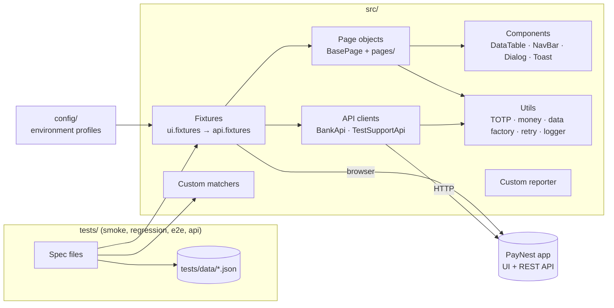
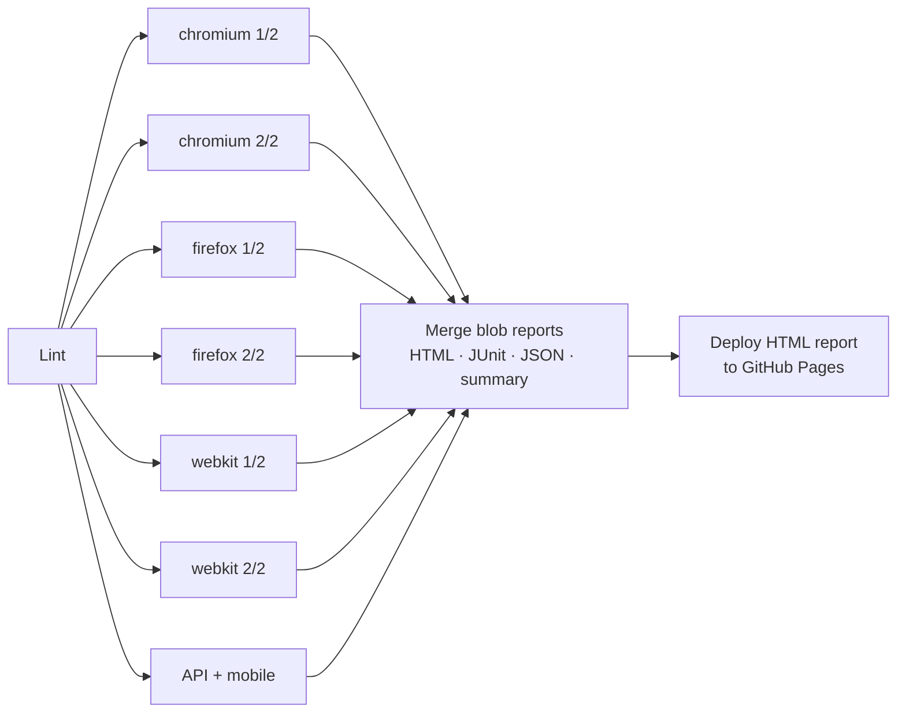

# PayNest Banking: Playwright Test Automation Framework

[](https://github.com/Sadia-Sultana-Bristy/paynest-banking-playwright-framework/actions/workflows/playwright.yml)


📊 **[Live test report](https://sadia-sultana-bristy.github.io/paynest-banking-playwright-framework/)**: the merged cross-browser HTML report from the latest run on `main`, with traces, videos and screenshots for any failure.

An enterprise-style UI and API test automation framework built with **Playwright and JavaScript** for **PayNest**, a demo online banking application. It tests sign-in with multi-factor authentication, account balances, fund transfers with daily limits, payee management, transaction history with CSV export, and an admin console for locking and unlocking customers.

The framework is designed around the problems real automation suites run into at scale: **test data collisions in parallel runs, slow UI-driven setup, flaky waits, unreadable CI failures and reports split across shards**.

> PayNest is a fictional bank. The application in `app/` is a small, dependency-free Node.js app written only so the framework has a realistic, deterministic system to test.

---

## Highlights

| Area | What the framework does |
|---|---|
| **Architecture** | Page Object Model on a shared `BasePage`; reusable UI components (data table, nav bar, dialog, toast); separate API layer |
| **Fixtures** | Layered custom fixtures: API fixtures → UI fixtures. Page objects, signed-in customers and admins are injected, never constructed in tests |
| **Test data** | Every test creates its **own customer** through a test-support API and deletes it afterwards, so all tests run fully in parallel |
| **Speed** | Authentication through the API (password + TOTP) in milliseconds; the login UI is covered by its own tests |
| **Real MFA** | An RFC 6238 TOTP generator passes MFA exactly like an authenticator app. MFA is never disabled for testing |
| **Data-driven** | Validation rules live in JSON files (`tests/data/`) and generate one test per row |
| **Custom matchers** | `toShowMoney`, `toBeSortedBy`, `toBeCsvWithHeader`: assertions that read like business rules |
| **Configuration** | Environment profiles (`local`, `ci`, `staging`) with `.env` and env-var overrides, validated at startup |
| **Parallel + sharded** | `fullyParallel` locally; in CI, 7 parallel jobs (3 browsers × 2 shards + API/mobile) |
| **Retries** | 0 locally, 2 in CI; a trace is recorded on the first retry; flaky tests are listed separately in reports |
| **Failure evidence** | Screenshot, video, trace, browser console errors, failed requests and page URL attached automatically |
| **Reporting** | HTML, JUnit and JSON reports, plus a custom reporter that summarises results by tag and browser into the GitHub job summary. Shard reports are merged into one |
| **CI/CD** | GitHub Actions: lint → cross-browser matrix → merged report → published to GitHub Pages. Runs on every push, PR and nightly |

## Test coverage

**64 test cases** (50 UI + 14 API). A full CI run executes **168 tests**: every UI test on Chromium, Firefox and WebKit, the smoke suite on a Pixel 7 viewport, and the API suite.

| Suite | Tag | Tests | What it proves |
|---|---|---:|---|
| Smoke | `@smoke` | 6 | Sign-in with MFA, dashboard balances, navigation, a transfer, API health |
| Regression | `@regression` | 53 | Auth and lockout, transfer rules and limits, payees, transaction filters and export, admin, API rules |
| End-to-end | `@e2e` | 2 | Full customer journey (payee → payment → history → statement); lockout → admin unlock → sign-in across two browser contexts |

Feature tags (`@auth`, `@transfers`, `@payees`, `@transactions`, `@admin`) and risk tags (`@critical`, `@security`, `@boundary`, `@limits`) can be combined, e.g. `--grep "@transfers.*@boundary"`.

## Architecture



The full design rationale is in **[docs/ARCHITECTURE.md](docs/ARCHITECTURE.md)**.

## Project structure

```
├── .github/workflows/playwright.yml   CI: lint → browser matrix (sharded) → merge reports → GitHub Pages
├── app/                               Demo system under test (PayNest bank: Node API + SPA)
├── config/
│   ├── environments.js                Environment profiles: local, ci, staging
│   └── index.js                       Resolves .env + env vars, validates, freezes config
├── src/
│   ├── api/                           BaseApiClient (errors, retries) · BankApi · TestSupportApi
│   ├── components/                    Reusable UI pieces: DataTable, NavBar, ConfirmDialog, Toast
│   ├── fixtures/                      api.fixtures.js (no browser) · ui.fixtures.js (pages, sessions, diagnostics)
│   ├── hooks/global-setup.js          Health check, test-support key check, run metadata
│   ├── pages/                         BasePage + one page object per screen
│   ├── reporters/                     Tag/browser summary reporter (Markdown + GitHub job summary)
│   ├── support/custom-matchers.js     toShowMoney, toBeSortedBy, toBeCsvWithHeader
│   └── utils/                         totp, money, data-factory, retry, logger
├── tests/
│   ├── api/                           API-layer tests (no browser)
│   ├── data/                          Data-driven test inputs (JSON)
│   ├── e2e/                           Multi-step business journeys
│   ├── regression/                    Feature-level regression by area
│   └── smoke/                         Critical-path checks for every build
├── docs/                              Architecture, setup, execution and framework guides
├── playwright.config.js               Projects, retries, reporters, evidence, webServer
└── merge.config.js                    Reporters used when merging sharded CI results
```

## Quick start

```bash
git clone https://github.com/Sadia-Sultana-Bristy/paynest-banking-playwright-framework.git
cd paynest-banking-playwright-framework
npm ci
npx playwright install --with-deps

npm test                 # everything (Playwright starts the demo app automatically)
npm run test:smoke       # smoke suite only
npm run report           # open the HTML report
```

Full instructions: **[docs/SETUP.md](docs/SETUP.md)**

## Running tests

| Command | Runs |
|---|---|
| `npm test` | All projects: API, Chromium, Firefox, WebKit, mobile smoke |
| `npm run test:smoke` / `test:regression` / `test:e2e` | One suite, by tag |
| `npm run test:api` | API layer only (no browser) |
| `npm run test:chromium` | Chromium + API (fastest full check) |
| `npm run test:cross-browser` | Chromium, Firefox and WebKit |
| `npm run test:headed` / `test:debug` / `test:ui` | Watch, step through, or use UI mode |
| `npm run test:flaky-check` | Every Chromium test 5 times with retries off |
| `npx playwright test --grep @transfers` | Any tag or combination |
| `TEST_ENV=staging BASE_URL=https://... npm test` | Another environment |

More options, including sharding, environments and debugging with the trace viewer: **[docs/EXECUTION.md](docs/EXECUTION.md)**

## CI/CD pipeline



* **Triggers:** every push (any branch), pull requests to `main`, nightly at 02:30 UTC, and manual runs with an optional tag filter.
* **Evidence:** each job uploads its blob report; failing jobs also upload screenshots, videos and traces.
* **One report:** the merge job combines all 7 jobs into a single HTML report, publishes JUnit/JSON artifacts, and writes a pass/fail/flaky table by browser and tag to the run's summary page.
* **Live report:** on `main`, the merged report is deployed to GitHub Pages.
* **Safety:** `forbidOnly` fails CI if a `test.only` is committed; concurrency cancels outdated runs on the same branch.

## Writing a test

```js
const { test, expect } = require('../../src/fixtures/ui.fixtures');

test.describe('Transfers', { tag: ['@regression', '@transfers'] }, () => {
  // optional: shape the customer this file needs
  test.use({
    customerProfile: {
      accounts: [
        { type: 'CHECKING', name: 'Everyday Checking', balance: 900_00 },
        { type: 'SAVINGS', name: 'High-Yield Savings', balance: 0 },
      ],
    },
  });

  test('a transfer updates the balance', async ({ signedInCustomer, transferPage, bankApi }) => {
    const [checking, savings] = signedInCustomer.accounts;   // created for this test only
    await transferPage.open();
    await transferPage.send({ from: checking.name, to: savings.name, amount: '25.00' });

    expect(await bankApi.balanceOf(checking.id)).toBe(checking.balance - 25_00);  // verify the ledger, not just the UI
  });
});
```

Conventions, review checklist and how to add pages, fixtures and data sets: **[docs/FRAMEWORK-GUIDE.md](docs/FRAMEWORK-GUIDE.md)**

## Key design decisions

1. **Tests own their data.** No shared seed users, so there's no ordering, no cleanup races and no "works alone, fails in the suite".
2. **Arrange through the API, act through the UI, assert on both.** UI time is spent only on the behaviour under test; balances are checked in the ledger as well as on screen.
3. **No hard waits.** Web-first assertions and an app "ready" signal (`data-route` + `aria-busy`); `no-wait-for-timeout` is a lint error.
4. **Retries are for diagnosis, not for hiding bugs.** Retries are off locally; in CI a retried pass is reported as *flaky* with a trace, and `test:flaky-check` exists to reproduce it.
5. **Accessible locators first.** `getByRole` and `getByLabel` everywhere; `data-testid` only for data regions such as cards and tables.

## Documentation

| Document | Contents |
|---|---|
| [Architecture](docs/ARCHITECTURE.md) | Layers, fixture graph, data strategy, waiting and retry strategy, design decisions |
| [Setup guide](docs/SETUP.md) | Prerequisites, installation, configuration, running the demo app manually |
| [Execution guide](docs/EXECUTION.md) | Commands, tags, projects, environments, sharding, CI triggers, reports, debugging |
| [Framework guide](docs/FRAMEWORK-GUIDE.md) | Conventions, adding pages, fixtures and data-driven tests, review checklist |

## Author

**Sadia Sultana Bristy**, SQA Engineer · [Portfolio](https://sadia-sultana-bristy.github.io) · [LinkedIn](https://www.linkedin.com/in/sadia-sultana-bristy/)

Licensed under the [MIT License](LICENSE).
